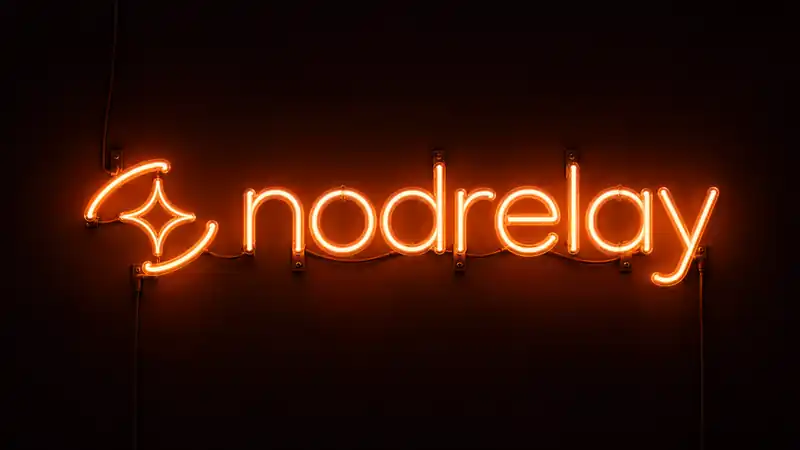

<p align="center">
  
</p>

# Nodrelay

English | [简体中文](README_zh-cn.md)

Nodrelay is a self-hosted relay for local MCP servers. It connects the MCP servers on any computer (stdio servers started by a command, or HTTP servers listening only on that computer) to **one** Cloudflare MCP Portal through Cloudflare Tunnel. Your MCP client connects to that single address and uses the MCP servers on every computer you have set up.

Nodrelay lets remote clients call tools on your computers, which can include reading and writing files and running commands. Deploy it only on computers you own or are authorized to manage, and restrict the Portal's Access policy to yourself. You are responsible for how you deploy and use it; the developers accept no liability for unauthorized access, command execution or other misuse and its consequences.

[Documentation](docs/managed-deployment.md) · [Releases](https://github.com/Erlin0220/nodrelay/releases) · [Report a security issue](SECURITY.md)

## Features

- **One Portal, many computers:** each computer has its own Tunnel and credentials. The Portal keeps tools apart per computer and MCP server, and clients can switch single servers on or off.
- **Any local MCP:** stdio servers started by `command`, plus local HTTP and SSE servers, in the same format Claude Desktop, Cursor and VS Code use, so existing entries import as they are.
- **Configuration stays on the computer:** which MCP servers and tools a computer offers is decided on that computer. The console can show and disable them but cannot add or change the commands a computer runs.
- **Self-hosted:** the console is a Worker and D1 database in your own Cloudflare account, with no third-party server in between. Computers never sign in to Cloudflare.
- **One-line install:** one command each for macOS, Linux and Windows. Install codes never expire, work once and can be revoked.
- **DevSpace built in:** Personal DevSpace (workspaces, file edits, commands) works out of the box.

## Quick start

### 1. Deploy the console (on a Mac)

```zsh
zsh <(curl -fsSL https://github.com/Erlin0220/nodrelay-downloads/releases/download/v0.1.1/install-macos.sh)
```

Authorize Cloudflare in the browser that opens, then pick an account and a domain with the arrow keys. The installer deploys the Worker, D1, Access and the MCP Portal, confirms each step through the Cloudflare API, and opens the console. The account needs an active domain.

### 2. Connect a computer

In the console choose **Add device** and name it, then **Install command** on its row. Copy the command for that computer's system and run it there:

```sh
# macOS
zsh <(curl -fsSL https://raw.githubusercontent.com/Erlin0220/nodrelay/refs/heads/main/install.sh) -e https://<console> -t <code>
# Linux
bash <(curl -fsSL https://raw.githubusercontent.com/Erlin0220/nodrelay/refs/heads/main/install.sh) -e https://<console> -t <code>
```

```bat
:: Windows (cmd or PowerShell)
powershell.exe -NoProfile -ExecutionPolicy Bypass -Command "try { iwr 'https://raw.githubusercontent.com/Erlin0220/nodrelay/refs/heads/main/install.ps1' -UseBasicParsing -OutFile 'nodrelay-install.ps1' -ErrorAction Stop; & '.\nodrelay-install.ps1' '-e' 'https://<console>' '-t' '<code>' } catch { throw }"
```

### 3. Add the MCP servers on that computer

The installer prints where its `nodrelay` command is (`~/.devspace-fleet/<instance>/nodrelay`):

```sh
# An MCP server started by a command
nodrelay mcp add files --allow read_text_file,list_directory,search_files -- npx -y @modelcontextprotocol/server-filesystem ~/Documents
# A local HTTP MCP server
nodrelay mcp add notes --url http://127.0.0.1:3000/mcp --header 'Authorization: Bearer <token>'
# Import an existing configuration
nodrelay mcp import ~/Library/Application\ Support/Claude/claude_desktop_config.json
# Check registration
nodrelay mcp list
```

They appear in the Portal within seconds. You can also edit the `mcp.json` shown by `nodrelay mcp path`:

```json
{
  "mcpServers": {
    "files": {
      "command": "/opt/homebrew/bin/npx",
      "args": ["-y", "@modelcontextprotocol/server-filesystem", "/Users/me/Documents"],
      "tools": { "allow": ["read_text_file", "list_directory", "search_files"] }
    },
    "notes": { "url": "http://127.0.0.1:3000/mcp", "headers": { "Authorization": "Bearer …" } }
  }
}
```

`tools.allow` and `tools.deny` limit the tools offered, and `"disabled": true` pauses a server. A `url` must point to this computer; add remote MCP servers to the Cloudflare MCP Portal directly.

### 4. Connect an MCP client

Add the Portal address shown in the console, `https://<portal>/mcp`, to ChatGPT, Claude, Cursor, VS Code or another client and sign in with Cloudflare Access.

## How it works

```text
MCP client → Cloudflare MCP Portal (Access login)
              ├─ Office Mac · files    ─┐
              ├─ Office Mac · devspace ─┼─ Tunnel → Nodrelay device service → local MCP (stdio / HTTP)
              └─ Home PC · notes       ── Tunnel → Nodrelay device service → local MCP
Admin      → Cloudflare Access → Nodrelay console (Worker + D1)
```

The device service listens only on loopback and serves each MCP server at `/mcp/<name>`. Each computer regularly reports the servers it offers; the console registers a server in the Portal only after its MCP handshake succeeds through the Tunnel, and removes it when the computer removes or disables it.

## Upgrade

- **Console:** use the upgrade icon next to the logo when it appears, or run the step 1 command again. Both keep the domain, database, login, Portal and connected computers.
- **Computers:** see [update and recovery](docs/device-recovery.md).

## Status

Preview: interfaces and package formats may change.

| Platform | State |
| --- | --- |
| macOS Apple Silicon | Installation, Tunnel and Portal tool calls verified |
| Windows x64 | Installation, repair, Tunnel and Portal tool calls verified |
| Linux x64 | Installed and reached over its Tunnel on Ubuntu 22.04 (WSL2); Portal calls on a standalone host pending |
| macOS Intel, Linux arm64 | Packaging supported; public packages pending |

- The device service runs as the signed-in user. For unattended Linux hosts, enable user lingering.
- The console needs a domain in your Cloudflare account; a `workers.dev` address cannot host the Tunnels and Portal.
- Local MCP servers are new and need the new device package; computers already installed keep offering DevSpace unchanged.

## Develop

Node.js 24 or later:

```sh
npm ci
npm test
```

## License

[MIT](LICENSE). Bundled Node.js, cloudflared, Personal DevSpace, Tabler Icons and npm dependencies keep their own licenses; their notices are collected under [`licenses/`](licenses) and in each package.
