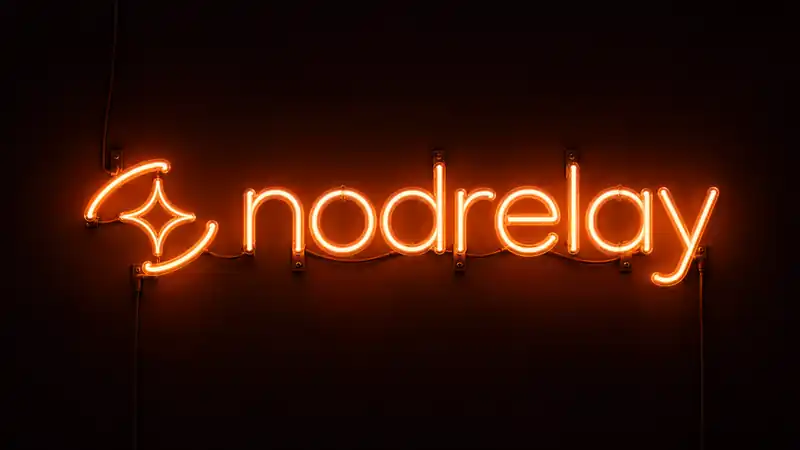

<p align="center">
  
</p>

<h1 align="center">诺联 Nodrelay</h1>

<p align="center">通过一个 Cloudflare MCP Portal，使用你所有的 Personal DevSpace 设备。</p>

<p align="center"><a href="README.md">English</a> · <a href="README_zh-cn.md">简体中文</a></p>

> **预览版。** 诺联仍在开发中，版本之间的接口和安装包格式可能还会变化。正式使用前请先看[当前状态](#当前状态)。

## 这是什么

诺联由两部分组成：

- **管理台**：部署在**你自己的** Cloudflare 账户里的 Worker 和 D1。它为每台设备单独创建 Tunnel 和凭据，生成安装命令，显示连接状态，并可随时撤销设备的访问。
- **设备服务**：运行在每台 macOS、Windows 或 Linux 设备上的小服务，通过设备自己的 Tunnel 把本机的 Personal DevSpace Runtime 接入 Portal。

MCP 客户端（ChatGPT、Claude、Cursor、VS Code 等）只需连接一个 Portal 地址，就能在你选定的设备上打开工作区、读写文件、执行命令。

```text
管理员     → Cloudflare Access → 诺联管理台（Worker + D1）
MCP 客户端 → Cloudflare MCP Portal → 设备 Tunnel → 设备服务 → Personal Runtime
```

除了你自己的 Cloudflare 账户和设备，不经过任何其他服务器。设备不需要登录 Cloudflare。

## 安装

### 1. 部署管理台（macOS）

```zsh
zsh <(curl -fsSL https://github.com/Erlin0220/nodrelay-downloads/releases/download/v0.1.1/install-macos.sh)
```

运行后浏览器会打开 Cloudflare 授权页。授权完成后，在终端里用方向键选择账户和域名。安装程序会部署 Worker、D1、Access 和 MCP Portal，每一步都通过 Cloudflare API 核对，完成后自动打开管理台。账户里需要有一个已激活的域名。想在执行前校验启动脚本，可以使用[带 SHA-256 校验的命令](https://github.com/Erlin0220/nodrelay-downloads/releases/download/v0.1.1/install-macos-command.txt)。

### 2. 添加设备

在管理台点「添加设备」，输入名称（最多 20 个字）。再点设备行的「安装命令」，复制对应系统的命令，在那台设备上运行：

```sh
# macOS
zsh <(curl -fsSL https://raw.githubusercontent.com/Erlin0220/nodrelay/refs/heads/main/install.sh) -e https://<管理台地址> -t <安装码>
# Linux
bash <(curl -fsSL https://raw.githubusercontent.com/Erlin0220/nodrelay/refs/heads/main/install.sh) -e https://<管理台地址> -t <安装码>
```

```powershell
# Windows（cmd 或 PowerShell 均可）
powershell.exe -NoProfile -ExecutionPolicy Bypass -Command "try { iwr 'https://raw.githubusercontent.com/Erlin0220/nodrelay/refs/heads/main/install.ps1' -UseBasicParsing -OutFile 'nodrelay-install.ps1' -ErrorAction Stop; & '.\nodrelay-install.ps1' '-e' 'https://<管理台地址>' '-t' '<安装码>' } catch { throw }"
```

[`install.sh`](install.sh) 和 [`install.ps1`](install.ps1) 里没有任何凭据。它们向你的管理台读取为这台设备锁定的安装程序；安装程序会下载获准的安装包、校验 SHA-256，再安装设备服务。安装码不会过期，只能使用一次，可在管理台随时撤销。使用前请像密码一样保管。

### 3. 连接 MCP 客户端

把管理台显示的 Portal 地址（`https://<portal>/mcp`）添加到 MCP 客户端，用 Cloudflare Access 登录即可。需要放行某个客户端的 OAuth 回调时，在管理台的「客户端回调设置」里添加。

## 升级

- **管理台**：Logo 旁出现升级图标时（只有确认存在经过签名的新版本才会出现）点击升级；也可以重新运行第 1 步的命令。两种方式都会保留域名、数据库、登录配置、Portal 和已接入的设备。
- **设备**：按[更新与恢复指南](docs/device-recovery.md)操作。

## 当前状态

| 平台 | 状态 |
| --- | --- |
| macOS Apple Silicon | 已验证安装、Tunnel 和通过 Portal 调用工具 |
| Windows x64 | 已验证安装、修复、Tunnel 和通过 Portal 调用工具 |
| Linux x64 | 已在 Ubuntu 22.04（WSL2）完成安装并经 Tunnel 访问；独立主机上的 Portal 调用待验收 |
| macOS Intel、Linux arm64 | 已支持打包；公开安装包和验收待完成 |

已知限制：

- 设备服务以当前登录用户的身份运行：macOS 用 LaunchAgent，Windows 用交互式计划任务，Linux 用 systemd 用户服务。Linux 主机无人值守运行时，请为该用户开启 linger。
- 管理台需要使用你 Cloudflare 账户里的域名。设备 Tunnel 和 MCP Portal 都建在这个域名下，`workers.dev` 地址无法承载。
- 公开的管理台安装包使用的 Cloudflare OAuth 客户端只允许其所属账户授权。要部署到其他账户，请用自己的 OAuth 客户端重新打包。参阅 [Cloudflare OAuth 客户端可见性说明](https://developers.cloudflare.com/fundamentals/oauth/create-an-oauth-client/#private-and-public-clients)。

## 文档

- [在 macOS 上部署管理台](docs/management-macos.md)
- [托管部署、设备接入与发行验收](docs/managed-deployment.md)
- [更新与恢复](docs/device-recovery.md)

## 本地开发

需要 Node.js 24 或更高版本：

```sh
npm ci
npm test
```

手动运行单个设备适配器时，从 [`docs/device.example.json`](docs/device.example.json) 开始，并把凭据放在仅本机用户可访问的目录里：

```sh
npm start -- /absolute/private/device.private.json
```

发现安全问题请按 [SECURITY.md](SECURITY.md) 私下报告。

## 许可证

[MIT](LICENSE)。安装包中的 Node.js、cloudflared、Personal DevSpace、Tabler Icons 和 npm 依赖遵循各自的许可证，相关声明收录在 [`licenses/`](licenses) 和各依赖目录中。
